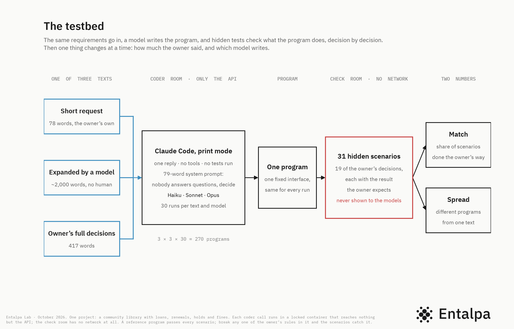
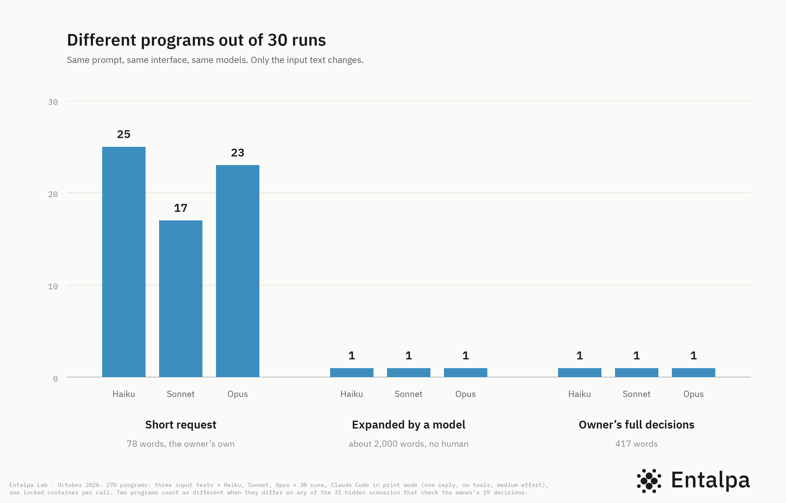
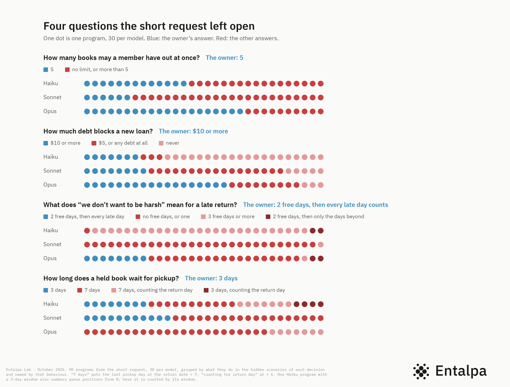
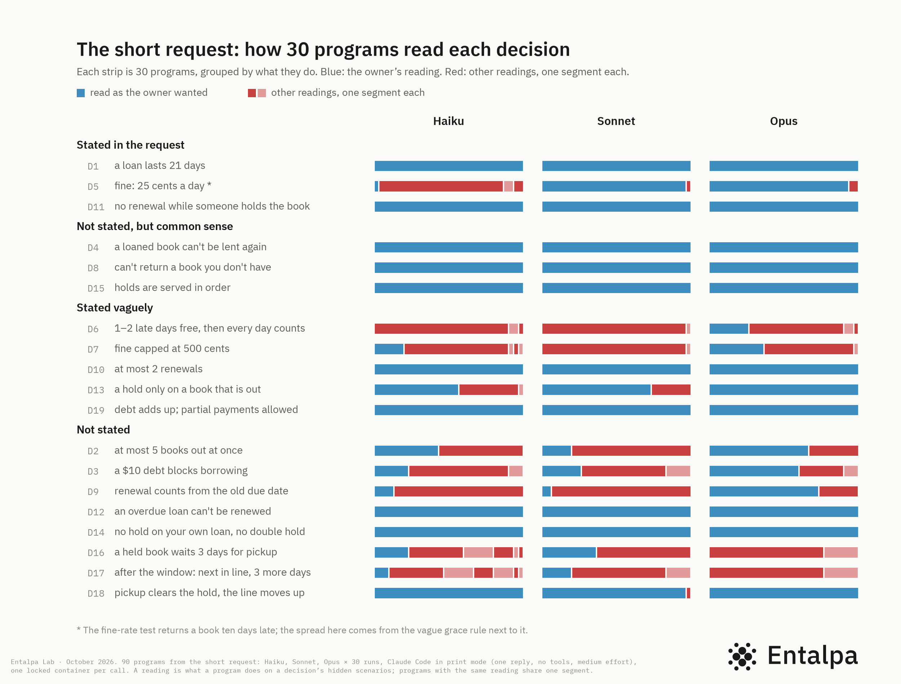

# Who is nondeterministic, the model or the human?

The testbed behind the write-up of the same name, published on 3 November 2026:
https://dev.to/entalpa/who-is-nondeterministic-the-model-or-the-human-1o7c

The same text goes to a coding model many times. Fixed scenarios check what each program
does, decision by decision. Then one thing changes at a time: how much the owner said, and
which model writes. This folder is the testbed as it was on the day of the write-up: the code,
the prompts, the three input texts, the owner's hidden decisions, and everything the 270 runs
produced.

## What came out

| Text in | Runs | Different programs | Match with the owner |
|---|---|---|---|
| The owner's short request, 78 words | 90: 30 each on Haiku, Sonnet, Opus | 64 (25, 17, 23) | 74%, 77%, 82% |
| The request expanded by Claude Opus alone, about 2,000 words | 90 | 1 | 80%, wrong on 5 of the 19 decisions |
| The owner's full decisions, 20 rules, 417 words | 90 | 1 | 100% |

- 9 of the 19 decisions read the same way in all 90 short-request programs: every rule the
  owner stated, and plain common sense. The other 10 split. All 10 are decisions the owner left
  out or said vaguely.
- The models did not miss the gaps. Each run was asked to list every decision it had to make
  because the text did not say. The lists name the pickup window in 90 runs of 90 and the debt
  rule in 90 of 90, in the same voice as the rules the owner did state. Not one list marks a
  line as a guess.
- The expansion's 5 misses all sit among the 10 decisions where the short request had split.
  Ten expansions of the same request, each compiled 10 times: no spread inside any of them, ten
  different programs across them, each right on 11 to 15 decisions of 19. Three of the owner's
  rules appear in none of the ten.
- All 270 code files differ. Behavior differs only where the text left a hole.

## How the testbed works

- **One project**: a community library with members, books, loans, renewals, holds and fines.
  One fixed interface for every run, `projects/library/interface.md`, so every program can be
  checked the same way.
- **Three texts go in**: `projects/library/specs/raw.md`, the owner's short request;
  `projects/library/specs/ai-opus-5-5.md`, the request expanded into a full spec by Claude Opus
  with no human in the loop (`-01` to `-10` are the ten further expansions);
  `safe/projects/library/specs/truth.md`, the owner's full decisions written as requirements.
- **The coder room**: one `claude -p` call, no tools, no MCP servers, no saved session, our own
  79-word system prompt (`prompts/compile.md`), in a locked container that can reach nothing but
  the API through a gate (`compose.yaml`, `rooms/coder`, `rooms/gate`). The prompt that expands
  a request is `prompts/expand.md`.
- **The check room**: the owner's 19 decisions (`safe/projects/library/truth.md`) and 31
  scenarios with the results the owner expects (`safe/projects/library/scenarios.mjs`), run
  against each program in a container with no network. A reference implementation passes every
  scenario; `lib/mutants.mjs` breaks one rule at a time to show the scenarios catch it.
- **Two numbers**: match, the share of scenarios a program does the owner's way; spread, how
  many different programs one text gave. Two programs are the same when they behave the same on
  every scenario. `lib/analyze.mjs` and `lib/entropy.mjs` compute them, `lib/tables.mjs` prints
  the tables behind the write-up.

`HYPOTHESES.md` was written before the runs, including the hypothesis that failed.

## What is in this folder

    lib/            the testbed: rooms, gate, coder, checker, analysis, tables
    prompts/        compile.md (the coder's system prompt) and expand.md
    projects/       library: the fixed interface, the short request, the eleven expansions
    rooms/          the coder room image, the gate, and probes that try each room's locks
    compose.yaml    the two networks, the gate and the coder image
    scripts/        how the matrix, the baseline and the ten expansions were run
    safe/           the owner's side: decisions, labels, scenarios, reference, full decisions
    data/runs/library/<text>/<model>__<effort>/run-NN/
                    one run: response.json (the model's reply), impl.mjs (the program),
                    assumptions.txt (the decisions it says it made), observations.json
                    (what it did on every scenario), meta.json (model, effort, tokens, cost)
    data/runs/_expand/
                    the ten expansions as the model returned them
    data/results/   CSV tables rebuilt by analyze and entropy
    data/logs/      the logs of the three batch scripts
    charts/         the four charts of the write-up

The write-up uses the medium-effort cells only. `data/runs/library/raw` and `truth` also hold a
few runs at low and max effort; they are partial and not part of any claim.

## Reproduce the tables

No model calls, no Docker, Node 26:

    node lib/tables.mjs library cells        # also: rules | menu | ai | expansions | halves | where
    node lib/analyze.mjs library
    node lib/entropy.mjs library
    node lib/charts.mjs library out/         # plain SVG versions of charts 1 and 2 from the saved runs

`lib/paths.mjs` finds `safe/` and `data/` in this folder. `STAND_SAFE` and `STAND_DATA` point
them elsewhere.

## Run the models again

Docker, Node 26, and a Claude Code subscription token from `claude setup-token`, saved as
`~/.config/stand/coder.token`. The token enters the coder room as an environment variable and
can reach only the hosts the gate allows; `node lib/gate.mjs log` shows every attempt.

    docker compose --profile build build coder            # once: the coder room's image
    node lib/gate.mjs start                               # the networks and the gate
    node lib/check.mjs --locks                            # the check room's locks hold
    node lib/coder.mjs --locks                            # the coder room's locks hold
    node lib/check.mjs --project library --all            # re-check every saved run in the room
    node lib/mutants.mjs library                          # the scenarios catch broken rules
    node lib/run.mjs --project library --spec raw --model claude-haiku-5-5 --effort medium --runs 7
    node lib/run.mjs --project library --expand raw --model claude-opus-5-5   # a new expansion
    scripts/clean.sh                                      # removes the rooms, gate, networks, images

The 270 runs of the write-up cost about $14 at API prices and took about three hours of wall
time; the hundred compiles of the ten expansions, on Haiku, under one dollar. Runs 01 to 07 of
the first cells were made before the rooms existed (no `room` in their meta.json); everything
since runs inside.

## Caveats

- The owner's decisions were written by a Claude model. The models under test share its
  defaults, which favors match on decisions the short request does not state. Two unstated rules
  came out the owner's way in all 90 runs, a third in 89 of 90.
- The fixed interface names the concepts: holds, fines, a pickup deadline. A real 78-word
  request would do worse.
- One reply, no tools, no tests run by the model; three models from one vendor; Claude Code adds
  about 1,000 tokens of its own context to every call.
- The fine-rate scenario returns a book ten days late, so the spread on that decision comes from
  the vague grace rule next to it. `safe/projects/library/labels.json` has the footnote.
- Effort (low, max) was only partly run and is not in the write-up.
- The owner's decisions are public from now on. Future models may have seen them; new claims
  will use new hidden projects.

## Licenses

Code: MIT. Data, texts and charts: CC BY 4.0. See `LICENSE` and `LICENSE-DATA.md` in the root
of this repository.

Entalpa Lab is the research side of [Entalpa](https://entalpa.com), a spec-driven development
platform for AI coding agents.
